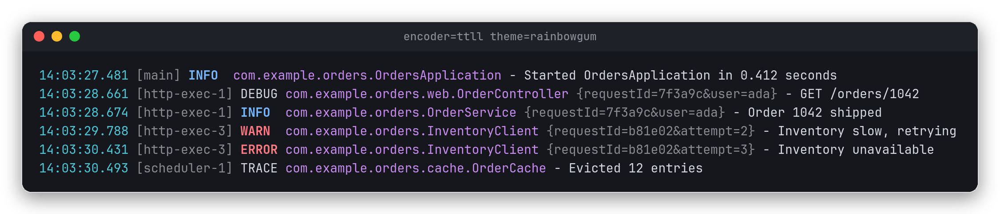
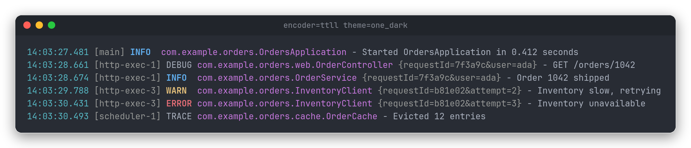
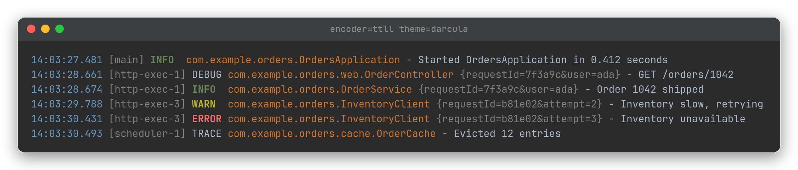
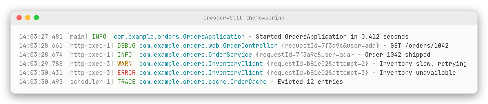
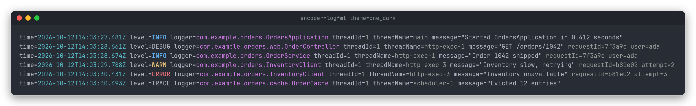
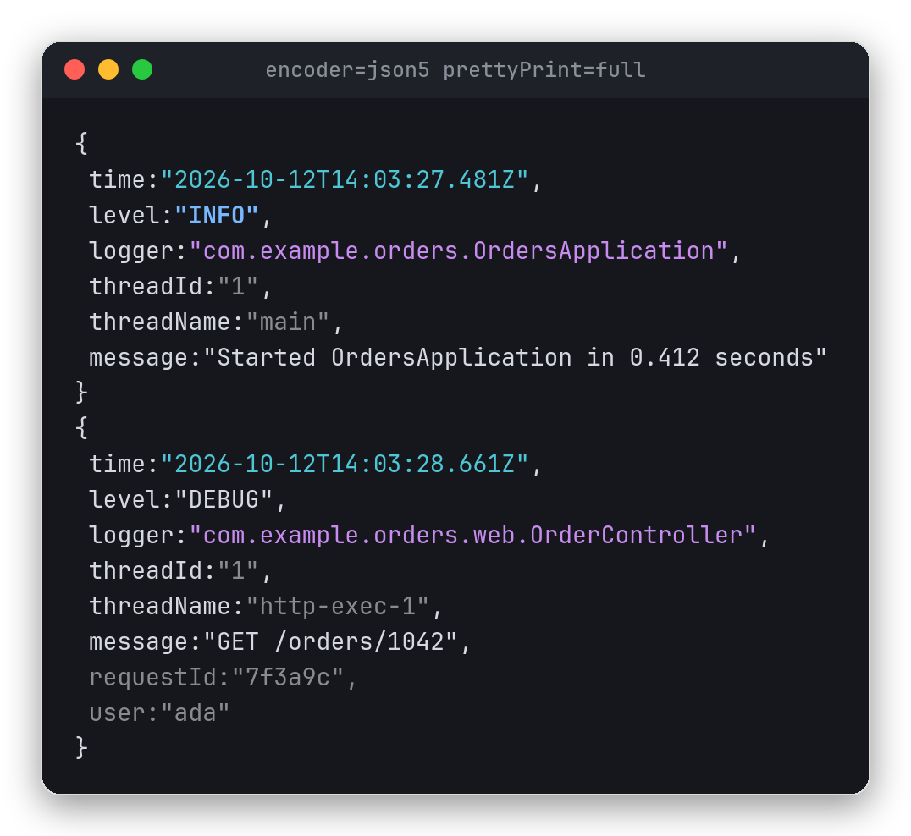

[](https://central.sonatype.com/search?q=g:io.jstach.rainbowgum)
[](https://jstach.io/doc/rainbowgum/current/apidocs)
[](https://jstach.io/rainbowgum/)
[](https://github.com/jstachio/rainbowgum/actions)
[](https://jstach.io/rainbowgum/coverage/)


# Rainbow Gum

A modern modular JDK 21+ logging framework that offers implementations for multiple facades
like SLF4J / System.Logger and does mostly what you want out of the box.

It is called **rainbow gum** after 
[Eucalyptus Deglupta](https://en.wikipedia.org/wiki/Eucalyptus_deglupta) a beautiful tree native
to Hawaii that has colorful bark ([*colorful logs*](#colorful-logs)).



In Rainbow Gum you can: 

* Leverage your existing configuration/application framework (like [avaje-config](https://avaje.io/config/) or Spring Boot `Environment`). 
* Do all your logging configuration in Java with a discoverable API of builders
* Only use System Properties and no loading of resources for a ultimate minimal experience
* Or various combinations of the above

Because Rainbow Gum is very modular it can provide a more "choose your own" experience where you can scale down and only use the JDK `System.Logger`
with minimal dependencies or scale up with fully loaded ANSI SLF4J experience. 
In some cases just adding modules will provide automatic configuration.

Rainbow Gum's default property configuration follows Spring Boot's patterns so if you are familiar with `logging.level...`
than you will feel at home with Rainbow Gum whether you use Spring or not.

Regardless of which configuration option you choose it is GraalVM native friendly, Jlinkable, and initializes hella fast.

The long term goal of Rainbow Gum is to be a logging framework **for all** with the only requirement being a modern JDK.

## Integration

Facades:

* [SLF4J 2.0](https://jstach.io/rainbowgum/#slf4j)
* [System.Logger and java.util.logging](https://jstach.io/rainbowgum/#system_logger), including a [java.util.logging `LogManager`](https://jstach.io/rainbowgum/#jul_avoid)
* [Log4j2 API](https://jstach.io/rainbowgum/#log4j2)
* [JBoss Logging](https://jstach.io/rainbowgum/#jboss_logging)
* [Commons Logging](https://jstach.io/rainbowgum/#commons_logging)

Frameworks:

* [Spring Boot 3 and 4](https://jstach.io/rainbowgum/#spring_boot), including [Actuator](https://jstach.io/rainbowgum/#spring_boot_actuator)
* [Micronaut](https://jstach.io/rainbowgum/#micronaut)
* [Helidon SE 4 and 27](https://jstach.io/rainbowgum/#helidon)
* [Avaje Config](https://jstach.io/rainbowgum/#config_properties)

Formats:

* [JSON](https://jstach.io/rainbowgum/#json_encoders) ([ECS](https://jstach.io/rainbowgum/#ecs), [GELF](https://jstach.io/rainbowgum/#gelf), [Logstash](https://jstach.io/rainbowgum/#logstash), [Logback](https://jstach.io/rainbowgum/#logback_json))
* [JSON5 and plain JSON](https://jstach.io/rainbowgum/#core_json) built into core
* [LTSV](https://jstach.io/rainbowgum/#ltsv)
* [logfmt](https://jstach.io/rainbowgum/#logfmt)
* [OpenTelemetry](https://jstach.io/rainbowgum/#otlp) ([OTLP/JSON](https://jstach.io/rainbowgum/#otlp_encoder), [OTLP/HTTP](https://jstach.io/rainbowgum/#otlp_output))
* [TTLL](https://jstach.io/rainbowgum/#ttll), the default text format
* [Logback style patterns](https://jstach.io/rainbowgum/#pattern)

## Documentation

* **[Latest SNAPSHOT RainbowGum doc](https://jstach.io/rainbowgum/)**
* **[Current released RainbowGum doc](https://jstach.io/doc/rainbowgum/current/apidocs)**

> [!WARNING]
> While this readme does contain some documentation the above is the preferred documentation and
> more likely to be up to date and correct!

The doc is also on javadoc.io but is not aggregated like the above.

Previous releases are listed at [jstach.io/doc/rainbowgum](https://jstach.io/doc/rainbowgum/).

### Using Rainbow Gum with coding agents

Start with [llms.txt](https://jstach.io/rainbowgum/llms.txt), which links the
[Markdown user guide](https://jstach.io/rainbowgum/overview.md) and migration guides for
[Logback](https://jstach.io/rainbowgum/migrate-logback.md) and
[Log4j2](https://jstach.io/rainbowgum/migrate-log4j2.md). These instructions help an agent
configure or migrate **your application**. They are usage guides, separate from the
[instructions for developing Rainbow Gum](development.md).

These links follow the latest snapshot. For a release, use `llms.txt` beside that
version's published Javadoc so the instructions match your dependency. The migration
guide sources live in [doc/agents](doc/agents); the doc build publishes them alongside
the generated Markdown user guide.


## Why choose Rainbow Gum

Covered in [why_rainbowgum_is_better.md](why_rainbowgum_is_better.md).

## Colorful logs

Rainbow Gum core comes with themes that work on four different formats also included in core: [TTLL](https://jstach.io/doc/rainbowgum/current/apidocs/index.html#ttll), [JSON5](https://jstach.io/doc/rainbowgum/current/apidocs/index.html#core_json), [logfmt](https://jstach.io/doc/rainbowgum/current/apidocs/index.html#logfmt), and [LTSV](https://jstach.io/doc/rainbowgum/current/apidocs/index.html#ltsv).

The console format below is [TTLL](https://jstach.io/doc/rainbowgum/current/apidocs/index.html#ttll) (time, thread, level, logger), colored with the "One Dark" theme
(note no pattern module or pattern string is needed and only one line of configuration is required):

```properties
logging.appender.console.encoder.ttll.theme=one_dark
```



`darcula` uses IntelliJ's colors:



`spring` matches Spring Boot's console colors and, like `rainbowgum`, uses the terminal's
own palette, so it works on light backgrounds too:



The same themes color the structured encoders in core. [`logfmt`](https://jstach.io/doc/rainbowgum/current/apidocs/index.html#logfmt) writes one `key=value` line
per event for Loki, Vector and Go tooling:

```properties
logging.appender.console.encoder.uri=logfmt
logging.appender.console.encoder.logfmt.theme=one_dark
```



[`json5`](https://jstach.io/doc/rainbowgum/current/apidocs/index.html#core_json) switches to structured output while you hunt a bug, here pretty printed:

```properties
logging.appender.console.encoder.uri=json5
logging.appender.console.encoder.json5.prettyPrint=full
```



Color is only written when the console supports ANSI, so piping to a file stays plain. The
screenshots are Rainbow Gum's real output rendered with xterm.js; see
[etc/screenshots/generate](etc/screenshots/generate/generate.sh).


## Developing Rainbow Gum

Covered in [development.md](development.md)
